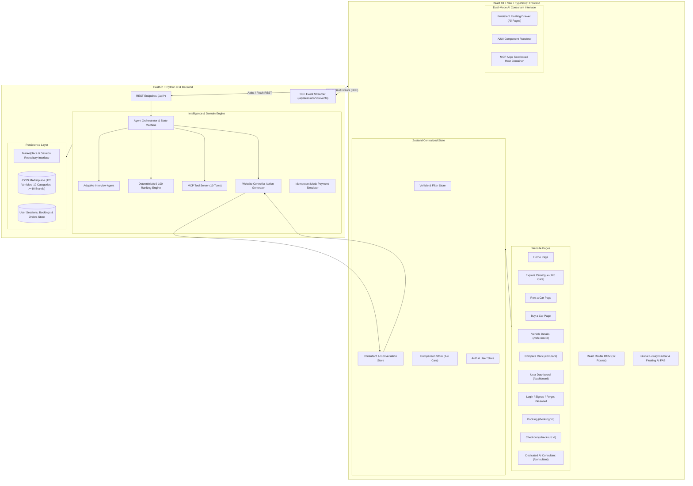

# AURA MOTORS: ARCHITECTURE & SYSTEM DESIGN
## AI-Powered Automotive Marketplace + Full-Stack Dynamic AI Consultant

---

## 1. Executive Summary

**Aura Motors** is a luxury automotive marketplace inspired by the design language of BMW, providing a complete full-stack platform for browsing, renting, purchasing, and comparing vehicles. 

Unlike traditional chatbots, the **Aura AI Consultant** is a **bidirectional website controller**:
1. **Agent-to-Website Control**: The AI directly navigates routes, sets filters, adds cars to comparison tables, opens vehicle detail sheets, and initiates bookings based on conversational requirements.
2. **Website-to-Agent Context**: The user's route, currently viewed car, active filters, and comparison list are continuously synchronized into the agent's memory.
3. **Embedded MCP Apps**: Renders sandboxed, protocol-compliant Model Context Protocol mini-applications for Vehicle Booking (`ui://booking-form`) and Mock Checkout (`ui://checkout-modal`) within the chat stream.
4. **Generative UI (A2UI)**: Streams declarative UI layout blueprints (`createSurface`, `updateComponents`, `actionResponse`) over Server-Sent Events (SSE).

---

## 2. Global Architecture Blueprint



---

## 3. The Website Controller Protocol

When the AI Consultant converses with the user, its backend returns both natural-language responses and structured **Website Action Objects**:

```typescript
export interface WebsiteAction {
  type: 
    | 'NAVIGATE_TO_PAGE'
    | 'APPLY_FILTERS'
    | 'CLEAR_FILTERS'
    | 'OPEN_VEHICLE_DETAILS'
    | 'ADD_TO_COMPARISON'
    | 'REMOVE_FROM_COMPARISON'
    | 'START_BOOKING'
    | 'OPEN_BOOKING_APP'
    | 'OPEN_CHECKOUT_APP';
  payload: Record<string, any>;
}
```

### Supported Action Handlers:
1. `NAVIGATE_TO_PAGE`:
   - Payload: `{ path: '/buy' | '/rent' | '/compare' | '/explore' }`
   - Invokes `navigate(path)` in React Router.
2. `APPLY_FILTERS`:
   - Payload: `{ category?: string, maxPrice?: number, transmission?: string, fuelType?: string, intent?: 'rent' | 'buy' }`
   - Directly updates `vehicleStore.setFilters(...)` and causes vehicle grids to re-filter instantly.
3. `OPEN_VEHICLE_DETAILS`:
   - Payload: `{ vehicleId: 'CAR-001' }`
   - Navigates to `/vehicles/CAR-001`.
4. `ADD_TO_COMPARISON`:
   - Payload: `{ vehicleIds: ['CAR-001', 'CAR-002'] }`
   - Adds cars to `comparisonStore`, updates navbar comparison badge, and navigates to `/compare`.
5. `OPEN_BOOKING_APP`:
   - Payload: `{ vehicleId: 'CAR-001', intent: 'rent' | 'buy' }`
   - Embeds the `ui://booking-form` MCP App inside the active chat drawer.
6. `OPEN_CHECKOUT_APP`:
   - Payload: `{ bookingId: 'BK-2026-90412', amount: 18290 }`
   - Embeds the `ui://checkout-modal` MCP App inside the active chat drawer.

---

## 4. Centralized State Store Architecture (Zustand)

1. `useVehicleStore`:
   - `vehicles`: All 120 vehicle records loaded from backend.
   - `filters`: `{ search, category, brand, minPrice, maxPrice, transmission, fuelType, seats, intent, sort }`
   - `filteredVehicles`: Computed dynamically via active filters.
   - `selectedVehicle`: Currently inspected vehicle.
2. `useConsultantStore`:
   - `isOpen`: Floating drawer open/close toggle.
   - `messages`: Conversation history.
   - `workflowState`: Active state machine stage.
   - `a2uiSurfaces`: Active generative UI surfaces.
   - `activeMcpApp`: Embedded booking or checkout MCP app.
   - `activeContext`: Current route & vehicle view context.
3. `useComparisonStore`:
   - `comparedVehicles`: Array of 2 to 4 vehicles.
   - `addVehicle(vehicle)` / `removeVehicle(id)` / `clearComparison()`.
4. `useAuthStore`:
   - `user`: Authenticated user profile.
   - `token`: JWT bearer token.
   - `savedVehicles`: Favorite vehicle IDs.
   - `bookings`: Active and past rental bookings.
   - `orders`: Purchase reservation orders.

---

## 5. Security & Isolation

- **Zero Arbitrary JavaScript**: Actions are strictly typed enumeration values executed by trusted client functions.
- **MCP App Sandboxing**: Iframes run with `sandbox="allow-scripts allow-forms allow-same-origin"` and Content Security Policy (CSP).
- **Authoritative Price Calculation**: Totals, deposits, and GST are always recalculated by the backend `/api/bookings/calculate`.
- **Mock Safety**: Payment simulations prominently display test disclaimers; no real card or banking credentials are ever accepted.
