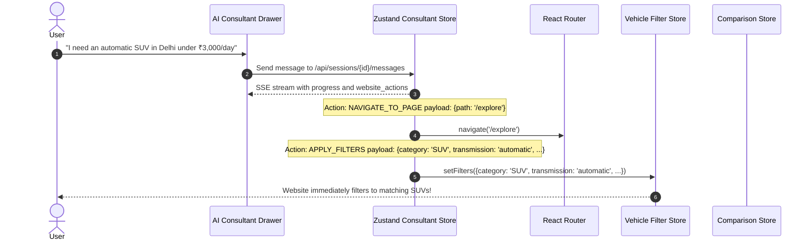
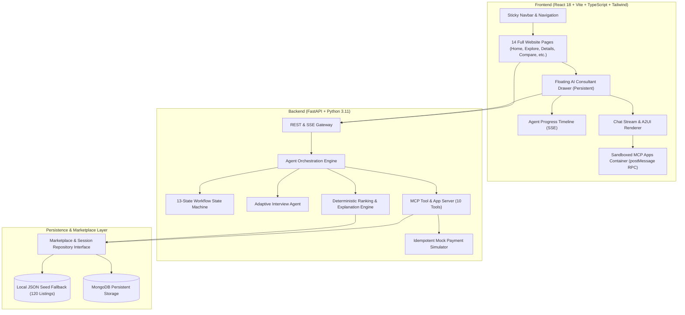
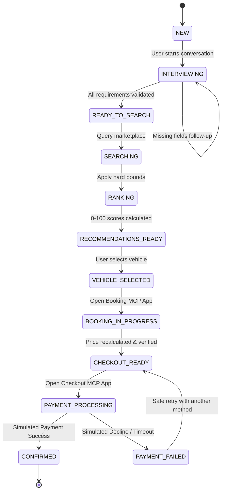

# Aura Motors: AI-Powered Luxury Automotive Marketplace & Dynamic Consultant
### Amulate Summer Hackathon 2026 Project

[](https://fastapi.tiangolo.com)
[](https://react.dev)
[](https://www.typescriptlang.org)
[](https://tailwindcss.com)
[](https://modelcontextprotocol.io)
[](https://a2ui.org)
[-brightgreen.svg)]()
[]()
[](LICENSE)

---

## 1. Project Overview & Vision

**Aura Motors** is a complete, production-grade automotive rental and purchase marketplace with a deeply integrated **AI-Powered Automotive Consultant that actively controls the website**.

Inspired by BMW's premium, minimal, and cinematic digital design language, Aura Motors pairs a full-featured automotive portal with an intelligent AI strategist that does not merely converse in text — it **dynamically navigates routes, applies catalogue filters, opens vehicle specifications, adds cars to side-by-side comparison matrices, and launches embedded checkout flows**.

### Key Architectural Pillars
1. **Full-Stack Automotive Website**: Complete multi-page portal with 120 validated vehicles spanning 10 distinct categories, featuring at least 10 distinct global brands in every single category.
2. **AI as an Active Website Controller**: Emits validated `website_actions` over Server-Sent Events (SSE) and JSON-RPC that manipulate React Router, state stores, and UI views in real time.
3. **Mandatory MCP Apps**:
   - `ui://booking-form`: Sandboxed booking configuration with live server price authority and add-ons recalculation.
   - `ui://checkout-modal`: Multi-rail payment simulation (UPI & Card) with deterministic grading scenarios (Instant Success, Decline, Timeout) and safety disclaimers.
4. **Generative UI via A2UI**: Streams declarative, safe UI component graphs (`createSurface`, `updateComponents`, `updateDataModel`) over SSE without executing arbitrary or unsafe JavaScript.
5. **Deterministic Mock Mode**: 100% offline, zero-cost operation with zero dependency on paid LLM tokens or external paid marketplace APIs.

---

## 2. Complete Website Routes & Capabilities

| Route | Page Name | Key Capabilities & Features |
|---|---|---|
| `/` | **Home** | Cinematic hero with video background, dual Rent/Buy search widget, featured vehicles, category showcase, testimonials, AI promo banner |
| `/explore` | **Explore Cars** | Complete 120-car catalogue, real-time multi-filter sidebar (Category, Brand, Transmission, Fuel, Budget), sorting by price & rating |
| `/rent` | **Rent a Car** | Dedicated rental booking flow with city selection, pickup/return calendars, daily budget filters, and instant availability search |
| `/buy` | **Buy a Car** | Purchase portal with New & Certified Used toggles, price slider (up to ₹2 Cr), 1-year comprehensive warranty, and loan calculator |
| `/vehicles/:id` | **Vehicle Details** | High-res gallery, full mechanical specs, standard equipment checklists, interactive EMI calculator, and "Ask AI About This Car" |
| `/compare` | **Compare Cars** | Side-by-side technical evaluation matrix for 2–4 vehicles, specs diffs, and "Ask AI Verdict" button for objective recommendation |
| `/booking/:vehicleId` | **Reservation** | Full journey scheduling, concierge add-ons (Zero-Dep, GPS, Child Seat), driver credentials verification, and live GST price calculation |
| `/checkout/:id` | **Checkout Simulator** | Simulated UPI & Card rails, mandatory mock notice, and deterministic hackathon test scenario selectors (Success, Decline, Timeout) |
| `/login` | **Client Login** | Minimal luxury authentication portal with 1-click instant demo sign-in as *Alex Vance* |
| `/signup` | **Client Registration**| New customer account creation with credentials validation |
| `/dashboard` | **User Dashboard** | Active fleet bookings with QR reference, saved vehicle garage, purchase enquiries, and quick concierge action triggers |
| `/about` | **Brand Heritage** | Aura Motors philosophy, 200-point inspection standards, flagship lounge locations (Delhi, Mumbai, Bengaluru) |
| `/contact` | **Concierge Desk** | 24/7 hotline numbers, concierge dispatch form, and zero-wait AI consultant trigger |
| `/consultant` | **Full-Screen AI** | Dedicated full-page consultant view with live state machine timeline, chat stream, and scenario pills |

---

## 3. How the AI Consultant Controls the Website

The AI Consultant is accessible on **every single page** via a persistent floating action button/drawer AND through the dedicated `/consultant` route. When the user converses with the consultant, the agent emits structured `website_actions`:



### Supported Controller Actions:
- `NAVIGATE_TO_PAGE`: Smoothly redirects React Router to any page (`/explore`, `/rent`, `/buy`, `/compare`, `/vehicles/:id`, `/booking/:id`, `/checkout/:id`).
- `APPLY_FILTERS`: Updates `vehicleStore` with extracted categories, fuel types, transmissions, locations, and budget bounds.
- `CLEAR_FILTERS`: Resets all active catalogue filters to default.
- `OPEN_VEHICLE_DETAILS`: Directly transitions to `/vehicles/:id` when the user asks to inspect a specific car.
- `ADD_TO_COMPARISON`: Synchronizes vehicle IDs into `comparisonStore` and opens the comparison page.
- `OPEN_BOOKING_APP`: Launches the embedded `ui://booking-form` MCP App inside the drawer.
- `OPEN_CHECKOUT_APP`: Launches the embedded `ui://checkout-modal` MCP App inside the drawer.

---

## 4. Architecture Diagram



---

## 5. Multistep Agent Workflow & State Machine

The orchestration engine validates every transition through a strict 13-stage Finite State Machine (FSM):



### The 10 Seed Categories (with $\ge$ 10 Distinct Brands Each):
1. **Hatchback** (Maruti Suzuki, Hyundai, Tata, Volkswagen, Toyota, Honda, Renault, Mini, Fiat, Ford)
2. **Sedan** (Honda, Hyundai, Skoda, Volkswagen, Maruti Suzuki, Toyota, Nissan, Mazda, Subaru, Kia)
3. **SUV** (Hyundai, Tata, Mahindra, Kia, Toyota, MG, Jeep, Volkswagen, Skoda, Nissan)
4. **Luxury Sedan** (Mercedes-Benz, BMW, Audi, Lexus, Jaguar, Genesis, Volvo, Porsche, Maserati, Alfa Romeo)
5. **Luxury SUV** (Land Rover, Porsche, Mercedes-Benz, BMW, Audi, Volvo, Lexus, Maserati, Aston Martin, Bentley)
6. **Electric Vehicle** (Tesla, Tata, Hyundai, Kia, BYD, MG, Mahindra, Polestar, BMW, Audi)
7. **Hybrid** (Toyota, Honda, Maruti Suzuki, Lexus, Hyundai, Kia, Ford, Subaru, Nissan, Volvo)
8. **MUV** (Toyota, Maruti Suzuki, Kia, Mahindra, Renault, Hyundai, Honda, Nissan, Mitsubishi, Mercedes-Benz)
9. **Sports Car** (Porsche, Ford, Chevrolet, Nissan, Toyota, BMW, Jaguar, Aston Martin, Audi, Lotus)
10. **Convertible** (Mazda, BMW, Mercedes-Benz, Audi, Mini, Porsche, Ford, Chevrolet, Jaguar, Lexus)

---

## 6. Mandatory MCP Apps Implementation

### App 1: Interactive Booking Form (`ui://booking-form`)
- **Container**: Sandboxed iframe embedded directly in the chat thread.
- **Protocol**:
  - `mcp-app:init`: Receives vehicle context, dates, user details.
  - `mcp-app:action` (`recalculate`): User toggles add-ons (Zero Depreciation Protection ₹750/day, Child Safety Seat ₹250/day). The app sends an RPC call to `/api/bookings/calculate`. The backend recalculates taxes (18% GST), subtotals, and returns authoritative numbers via `mcp-app:update`.
  - `mcp-app:finish`: Dispatches verified booking payload to create the pending booking.

### App 2: Mock Payment & Checkout (`ui://checkout-modal`)
- **Container**: Sandboxed iframe embedded directly in the chat thread.
- **Safety Disclaimer**: Prominently warns that the environment is simulated and no real funds are transferred.
- **Interactive Multi-Rail Simulation**:
  - **UPI Simulator**: Simulates Google Pay / PhonePe / Paytm authorization.
  - **Card Simulator**: Pre-populated test cards (`4242 •••• •••• 4242`, Exp `12/28`).
- **Deterministic Test Scenarios**:
  - `🟢 Instant Success`: Completes transaction, updates status to `CONFIRMED`, and generates booking voucher.
  - `🔴 Simulated Decline`: Fails transaction, preserves booking in `PENDING_PAYMENT`, displays safe retry without duplicating records.
  - `🟡 Gateway Timeout`: Simulates network timeouts.

---

## 7. Model Context Protocol (MCP) Tools

The backend registers 10 standard MCP tools accessible via `/api/` and internal MCP server:

| Tool Name | Type | Description |
|---|---|---|
| `search_vehicles` | Read-only | Filter marketplace by category, budget, dates, location, transmission, fuel |
| `get_vehicle_details` | Read-only | Fetch specifications, odometer, condition, and image URLs |
| `check_vehicle_availability` | Read-only | Detects booking interval overlaps for given dates |
| `compare_vehicles` | Read-only | Side-by-side spec and value comparison for up to 4 vehicles |
| `calculate_booking_total` | Read-only | Authoritative backend price recalculation with add-ons and taxes |
| `create_booking` | Transactional | Reserve a rental vehicle (enforces idempotency) |
| `create_purchase_order` | Transactional | Reserve a purchase vehicle with token deposit |
| `get_booking_status` | Read-only | Check status (`PENDING_PAYMENT`, `CONFIRMED`, `CANCELLED`) |
| `simulate_mock_payment` | Transactional | Execute simulated authorization scenario |
| `get_order_confirmation` | Read-only | Fetch verified booking confirmation voucher |

---

## 8. Quick Start & Local Development

### Prerequisites
- Python 3.11+
- Node.js 18+ & npm
- Git

### 1. Backend Setup
```bash
# Navigate to project root
cd car-consultant

# Create and activate virtual environment
python -m venv backend/venv
# Windows:
backend\venv\Scripts\activate
# Linux/macOS:
# source backend/venv/bin/activate

# Install dependencies
pip install -r backend/requirements.txt

# Start FastAPI server
uvicorn backend.app.main:app --host 0.0.0.0 --port 8000 --reload
```
Backend API will be accessible at `http://localhost:8000`. OpenAPI documentation at `http://localhost:8000/docs`.

### 2. Frontend Setup
```bash
# In a new terminal, navigate to frontend
cd car-consultant/frontend

# Install dependencies
npm install

# Start Vite development server
npm run dev
```
Open `http://localhost:5173` in your browser.

---

## 9. Docker Deployment

To launch the full containerized stack (Frontend, Backend, and MongoDB):

```bash
# Build and run containers in detached mode
docker compose up --build -d

# Verify container health
docker compose ps

# View backend logs
docker compose logs -f backend

# Stop services
docker compose down
```
- Frontend: `http://localhost:3000`
- Backend API: `http://localhost:8000`
- Health check: `http://localhost:8000/health`

---

## 10. Automated Testing Suite

All tests run deterministically without requiring paid API keys or network access.

```bash
# Run all backend unit, integration, and E2E tests (27 tests)
backend\venv\Scripts\python -m pytest backend/tests -v

# Run frontend contract & build integrity tests (4 tests)
node frontend/tests/frontend_contracts.test.mjs

# Run frontend production build (TypeScript + Vite)
cd frontend && npm run build
```

### Verified Test Categories:
1. `test_seed_matrix.py`: Verifies $\ge 100$ listings, 10 categories, and at least 10 distinct brands per category.
2. `test_ranking.py`: Verifies hard bounds, 0-100 score normalization, and zero-match diagnostic relaxations.
3. `test_preferences.py`: Verifies natural-language extraction for Scenarios A & B and missing field detection.
4. `test_pricing_and_idempotency.py`: Verifies authoritative GST calculations and duplicate payment prevention.
5. `test_state_machine.py`: Verifies valid vs blocked state transitions.
6. `test_mcp_tools.py`: Verifies all 10 MCP tools.
7. `test_e2e_scenarios.py`: Verifies end-to-end workflows for Scenarios A, B, C, and D.
8. `frontend_contracts.test.mjs`: Verifies frontend production bundle, MCP App lifecycles, and A2UI schema contracts.

---

## 11. Hackathon Demonstration Scenarios

### Scenario A: Rental Workflow & Website Navigation
1. User enters: *"I need an automatic SUV in Delhi for five days starting 15 December 2026. My budget is ₹3,000 per day."* (or clicks Scenario A pill).
2. The AI Consultant immediately triggers `NAVIGATE_TO_PAGE` (`/rent`) and applies relevant filters.
3. Agent extracts criteria, validates dates, filters inventory, and renders A2UI Vehicle Cards with match scores.
4. User clicks "Select & Book Vehicle" on Hyundai Creta SX (O).
5. `ui://booking-form` MCP App opens inside the conversation. User selects Zero Depreciation Protection. Subtotal and GST recalculate dynamically.
6. User clicks "Proceed to Checkout".
7. `ui://checkout-modal` MCP App opens inside chat. User selects UPI and "Instant Success".
8. Booking is confirmed, and a green Confirmed Booking Voucher appears with reference `BK-2026-XXXX`.

### Scenario B: Purchase Workflow
1. User enters: *"I want to buy a used automatic SUV in Delhi with a maximum budget of ₹15 lakh."*
2. AI Consultant navigates the website to `/buy`, sets the budget slider to ₹15 Lakh, and displays matching vehicles.
3. Agent highlights trade-offs (e.g. odometer reading, condition).
4. User selects vehicle $\rightarrow$ Purchase Reservation MCP App opens $\rightarrow$ User pays refundable token deposit (₹25,000) $\rightarrow$ Order confirmed.

### Scenario C: Zero Matching Inventory & Relaxation
1. User enters: *"I need an automatic convertible in Delhi for 5 days starting 15 December 2026 with a daily budget of ₹500."*
2. System detects 0 matches. Instead of hallucinating, it diagnoses that ₹500/day is below the lowest Convertible rate (₹5,800/day) and offers controlled suggestions to adjust budget or category.

### Scenario D: Payment Failure Recovery & Idempotency
1. User opens Checkout MCP App and selects "Simulated Decline".
2. Payment fails with decline notice. The booking remains in `PENDING_PAYMENT` (not confirmed).
3. User retries with "Instant Success".
4. Booking is now `CONFIRMED`. Repeating submission with the same idempotency key returns the cached confirmation without double charging.

---

## 12. Security, Mock Safety & Disclaimers

- **Strict Mock Environment**: No live banking networks, Stripe, or payment gateways are connected. No real card numbers, CVVs, or UPI PINs are ever requested or stored.
- **Server Price Authority**: The frontend never dictates the final payable amount. All totals are computed on the backend from repository rates.
- **Idempotency Protection**: All booking creations and payment requests enforce UUIDv4 idempotency keys.
- **Sandboxed MCP Apps**: Embedded apps run inside sandboxed frames with restrictive Content Security Policies (CSP).
- **Zero Committed Secrets**: `.env.example` is supplied with safe default configurations. No credentials exist in client bundles or Git history.

---

## 13. Project Structure

```
car-consultant/
├── backend/
│   ├── app/
│   │   ├── agents/          # Adaptive interview agent logic
│   │   ├── api/             # FastAPI routers (health, sessions, vehicles, bookings, payments, a2ui, auth)
│   │   ├── marketplace/     # Date availability & filtering
│   │   ├── mcp/             # MCP server & tool definitions (10 tools)
│   │   ├── models/          # Pydantic schemas (Vehicle, Preferences, Session, Booking, Order, Payment)
│   │   ├── orchestration/   # Finite State Machine & SSE event dispatcher
│   │   ├── ranking/         # Explainable ranking engine
│   │   ├── repositories/    # Marketplace & session storage (JSON fallback + MongoDB)
│   │   ├── services/        # Pricing & payment simulator
│   │   ├── config.py        # Settings & environment variables
│   │   └── main.py          # FastAPI application entrypoint
│   ├── data/
│   │   ├── generate_seed_data.py # Category-Brand matrix seed generator
│   │   └── vehicles.json    # 120 validated listings (10 categories, >=10 brands each)
│   ├── tests/               # 27 automated backend tests
│   ├── Dockerfile
│   └── requirements.txt
├── frontend/
│   ├── src/
│   │   ├── a2ui/            # A2UI protocol renderer
│   │   ├── components/      # Navbar, Footer, VehicleCard, EMICalculator, FloatingConsultantDrawer
│   │   ├── features/        # Chat container, message composer, progress timeline
│   │   ├── mcp-apps/        # Sandboxed MCP App Host container
│   │   ├── pages/           # Home, Explore, Rent, Buy, Details, Compare, Booking, Checkout, Auth, Dashboard, About, Contact, Consultant
│   │   ├── services/        # Backend API service & auth helpers
│   │   ├── store/           # Zustand stores (vehicles, comparison, auth, consultant)
│   │   ├── types/           # TypeScript interfaces
│   │   ├── App.tsx          # Root routing configuration
│   │   └── main.tsx
│   ├── tests/               # Frontend contract tests
│   ├── Dockerfile
│   └── package.json
├── mcp-apps/
│   ├── booking/             # Standalone ui://booking-form MCP App
│   └── checkout/            # Standalone ui://checkout-modal MCP App
├── specs/                   # 11 Spec-Driven Development documents
├── docs/                    # Architecture, checklist, slides outline, video script, screenshots
├── docker-compose.yml
├── .env.example
├── .gitignore
├── LICENSE
└── README.md
```

---

*Aura Motors — Designed and Engineered for the Amulate Summer Hackathon 2026.*
