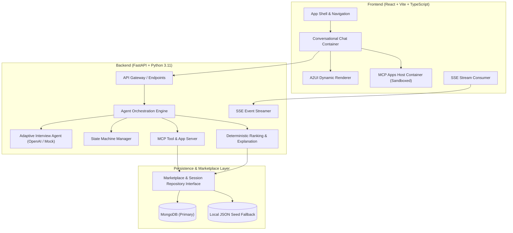
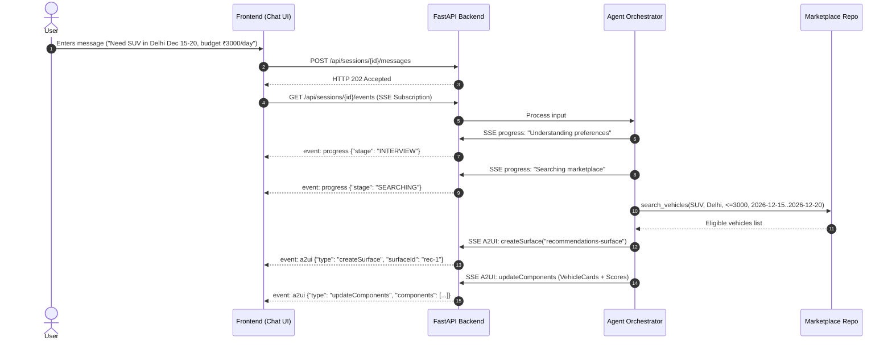
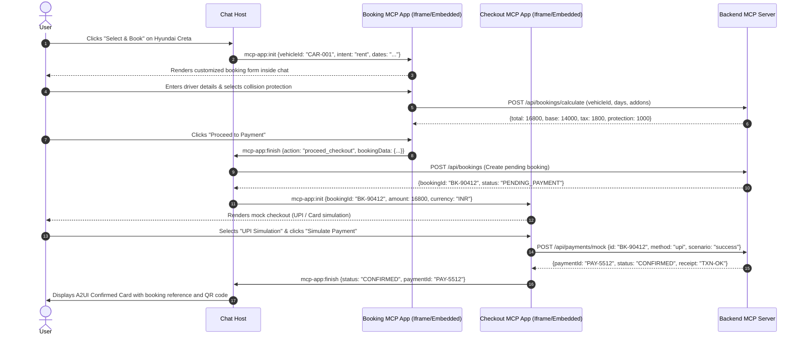

# AMULATE SUMMER HACKATHON 2026: ARCHITECTURE SPECIFICATION
## AI-Powered Car Rental and Purchase Consultant

---

## 1. System Architecture Overview

The system is designed as an agentic full-stack automotive platform with decoupled presentation, orchestration, domain logic, and persistent storage.

---

## 2. Component Breakdown

### 2.1 Frontend Architecture
- **Framework**: React 18 / 19 with TypeScript and Vite.
- **Styling**: Tailwind CSS configured for a premium automotive dark palette:
  - Deep Onyx: `#0A0A0C`
  - Charcoal Surface: `#121216`
  - Subtle Border: `#27272A`
  - Amber / Cyber Cyan accents: `#F59E0B` / `#06B6D4`
  - Emerald Success: `#10B981`
- **A2UI Renderer**: Custom protocol-compliant renderer interpreting flat component definitions, surfaces (`createSurface`, `updateComponents`, `updateDataModel`, `deleteSurface`), and emitting `actionResponse` payloads.
- **MCP Apps Host**:
  - Sandboxed host frame communicating via postMessage / JSON-RPC.
  - Supports `mcp-app:init`, `mcp-app:action`, `mcp-app:update`, and `mcp-app:finish` lifecycle events.
  - Hosts both `BookingFormApp` and `CheckoutApp`.

### 2.2 Backend Architecture
- **Framework**: FastAPI (async ASGI).
- **Agent Service**:
  - `AgentService` interface isolating model providers.
  - **OpenAI Agents SDK / Adapter**: Used when `OPENAI_API_KEY` is provided.
  - **Deterministic Mock Agent**: Complete, robust rules-based conversational engine that accurately parses intents, dates, budgets, categories, and brands from natural language, enabling 100% offline testing and zero-cost operation.
- **State Machine**:
  - Backend-validated workflow states (`NEW`, `INTERVIEWING`, `READY_TO_SEARCH`, `SEARCHING`, `RANKING`, `RECOMMENDATIONS_READY`, `VEHICLE_SELECTED`, `BOOKING_IN_PROGRESS`, `CHECKOUT_READY`, `PAYMENT_PROCESSING`, `CONFIRMED`, `PAYMENT_FAILED`, `CANCELLED`).
  - Guards against invalid transitions (e.g., cannot checkout without selecting a vehicle).
- **Ranking Engine**:
  - Step 1: Strict hard-constraint filtering (intent, location, price ceiling, dates, seating).
  - Step 2: Multi-criteria weighted normalization (budget 30%, category 25%, preferences 20%, rating 15%, brand 10%).
  - Step 3: Explainability generator extracting matched specs, trade-offs, and delta calculations.

### 2.3 Model Context Protocol (MCP) Architecture
- **MCP Server**: Implements official MCP tool specifications:
  - `search_vehicles(category, location, max_price, intent, fuel, transmission, seats, start_date, end_date)`
  - `get_vehicle_details(vehicle_id)`
  - `check_vehicle_availability(vehicle_id, start_date, end_date)`
  - `compare_vehicles(vehicle_ids)`
  - `calculate_booking_total(vehicle_id, intent, days, addon_ids)`
  - `create_booking(session_id, vehicle_id, dates, user_info, idempotency_key)`
  - `create_purchase_order(session_id, vehicle_id, user_info, deposit_amount, idempotency_key)`
  - `get_booking_status(booking_id)`
  - `simulate_mock_payment(order_or_booking_id, amount, method, scenario, idempotency_key)`
  - `get_order_confirmation(reference_id)`
- **MCP Apps**:
  - `ui://booking-form`: Interactive embedded app for collecting rental/purchase contact, driver license, add-ons, dates, calculating totals dynamically.
  - `ui://checkout-modal`: Interactive embedded app for reviewing charges, selecting mock payment methods (UPI, Card, Test Success, Test Decline), simulating processing, and returning transaction tokens.

### 2.4 Data & Persistence Strategy
- **Repository Pattern**:
  - `MarketplaceRepository`: Abstract base class.
  - `MongoMarketplaceRepository`: Persistent implementation using Motor / PyMongo.
  - `JsonMarketplaceRepository`: Deterministic file-backed fallback reading `data/vehicles.json` when MongoDB is not running.
- **Session & Transaction Store**:
  - Stores full session state, conversation history, workflow stage, active booking, and mock payment receipts.

### 2.5 Observability & Tracing
- **Langfuse & OpenTelemetry Integration**:
  - Structured tracing for LLM prompts, tool execution times, ranking durations, and user conversion events.
  - Non-blocking wrapper that operates as a silent no-op if `LANGFUSE_PUBLIC_KEY` is not set.

---

## 3. Communication Sequences

### 3.1 Live Agent SSE Timeline & A2UI Message Flow

### 3.2 MCP App Booking and Mock Checkout Flow

