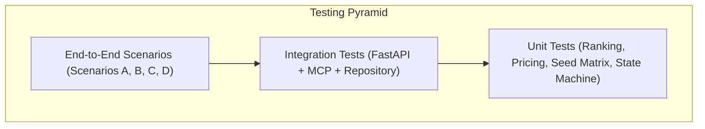

# AMULATE SUMMER HACKATHON 2026: TESTING SPECIFICATION
## AI-Powered Car Rental and Purchase Consultant

---

## 1. Test Strategy Overview

The testing suite guarantees 100% deterministic reproducibility without reliance on paid APIs or live network services.



---

## 2. Unit Testing Suite

### 2.1 Seed Data Matrix Test (`test_seed_matrix.py`)
- **Requirement**: At least 100 distinct listings across 10 categories, with at least 10 distinct brands represented in EVERY required category.
- **Verification**:
  ```python
  def test_category_brand_matrix():
      vehicles = load_seed_data()
      assert len(vehicles) >= 100
      categories = set(v.category for v in vehicles)
      assert len(categories) >= 10
      for cat in categories:
          brands_in_cat = set(v.brand for v in vehicles if v.category == cat)
          assert len(brands_in_cat) >= 10, f"Category {cat} has only {len(brands_in_cat)} brands, expected >= 10"
  ```

### 2.2 Preference Extraction & Validation (`test_preferences.py`)
- Test extraction of intent (`rent` vs `buy`).
- Test validation of dates (rejecting past dates, end date before start date).
- Test duration validation.
- Test missing mandatory fields detection (`interview_complete == False`).

### 2.3 Deterministic Ranking Engine (`test_ranking.py`)
- Test hard constraint exclusion (vehicles with manual transmission excluded when automatic requested).
- Test price ceiling cutoff.
- Test scoring normalization (0-100 score).
- Test brand preference weight distribution when no brand is specified.
- Test zero-result diagnostic generator identifying binding constraints.

### 2.4 Pricing & Idempotency (`test_pricing_and_idempotency.py`)
- Test authoritative calculation of base rate, add-ons, and taxes.
- Test rejection of duplicate booking submissions with same idempotency key.

### 2.5 Workflow State Machine (`test_state_machine.py`)
- Verify legal transitions: `NEW -> INTERVIEWING -> READY_TO_SEARCH -> SEARCHING -> RANKING -> RECOMMENDATIONS_READY -> VEHICLE_SELECTED -> BOOKING_IN_PROGRESS -> CHECKOUT_READY -> PAYMENT_PROCESSING -> CONFIRMED`.
- Verify illegal transitions are blocked: e.g., jumping from `NEW` to `CHECKOUT_READY`.

---

## 3. Integration Testing Suite

### 3.1 MCP Tools Suite (`test_mcp_tools.py`)
- Test all 10 MCP tools:
  - `search_vehicles`
  - `get_vehicle_details`
  - `check_vehicle_availability`
  - `compare_vehicles`
  - `calculate_booking_total`
  - `create_booking`
  - `create_purchase_order`
  - `get_booking_status`
  - `simulate_mock_payment`
  - `get_order_confirmation`

### 3.2 Mock Payment Simulator (`test_payment_simulator.py`)
- Scenario `success`: Confirms booking and generates receipt.
- Scenario `failure`: Retains pending status and returns decline code.
- Scenario `timeout`: Returns retryable error.

### 3.3 A2UI Protocol Validation (`test_a2ui_protocol.py`)
- Validate generated JSON messages match A2UI declarative schema.
- Validate component IDs reference existing children.

---

## 4. End-to-End Scenarios

| Scenario | Objective | Input / Action | Expected Result |
|----------|-----------|----------------|-----------------|
| **Scenario A: Rental** | Full 5-day rental discovery & booking | "Need automatic SUV in Delhi Dec 15-20, budget ₹3000/day" | Filtered SUVs displayed, Booking MCP App embedded, Payment simulated, Confirmed voucher rendered |
| **Scenario B: Purchase** | Used car purchase reservation | "Want to buy used automatic SUV in Delhi under ₹15 Lakhs" | Purchase-eligible SUVs displayed, Reservation MCP App opened, Token deposit paid, Order confirmed |
| **Scenario C: Zero Results** | Graceful constraint relaxation | "Convertible in Delhi for ₹500/day" | 0 results message, binding constraints highlighted, option to increase budget or change category |
| **Scenario D: Payment Recovery** | Safe decline & retry | Select "Simulated Decline" in MCP Checkout | Error shown in app, booking unconfirmed, user selects "Instant Success", booking confirmed idempotently |

